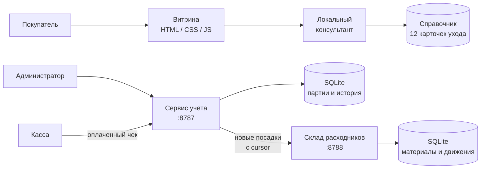

<div align="center">

# XROM Group / Plants

### Консультант по растениям и операционный контур питомника

<p>
  <strong>Выбирайте растения без лотереи.</strong><br>
  XROM отвечает по базе питомника, помогает подобрать растение под реальную жизнь<br>
  и связывает витрину с учётом партий и складом расходников.
</p>

<p>
  <a href="#быстрый-старт">Быстрый старт</a> ·
  <a href="#как-это-работает">Как это работает</a> ·
  <a href="#api-контур">API-контур</a> ·
  <a href="backend/README.md">Документация backend</a>
</p>


</div>

> **Кейс:** покупатель спрашивает о растениях и уходе — консультант отвечает по каталогу и базе знаний, а не придумывает уверенный ответ. Это минимальный работающий прототип части системы питомника.

---

## Зачем это нужно

У питомника две стороны одной задачи:

- **покупателю** нужен простой человеческий ответ: что выбрать, куда поставить и как ухаживать;
- **команде питомника** нужны партии, стадии роста, остатки, продажи и расход материалов без ручной сверки в таблицах.

XROM соединяет эти сценарии в одном учебном проекте. Витрина показывает идею продукта, консультант работает на локальной базе ответов, а backend хранит операционные данные и проводит изменения транзакционно.

## Что уже внутри

| Слой | Возможности | Точка входа |
| --- | --- | --- |
| **Витрина** | Адаптивная landing page, каталог, фильтры, избранное, учебная корзина, формы вопросов | [`index.html`](index.html) |
| **Консультант** | Ответы по базе, подбор через уточняющие вопросы, честный fallback, если знаний не хватает | [`app.js`](app.js) |
| **Справочник** | 12 карточек ухода: свет, полив, почва, зимостойкость, обрезка, цветение, высота | [`backend/catalog/plants.json`](backend/catalog/plants.json) |
| **Учёт растений** | SQLite, партии, места, стадии роста, календарь переходов, история, авторизация администратора | [`backend/server.mjs`](backend/server.mjs) |
| **Продажи** | Обезличенный оплаченный чек, FIFO-списание готовых партий, защита от повторной проводки | [`backend/sales.mjs`](backend/sales.mjs) |
| **Склад расходников** | Закупки, ручные списания, нормы на растение, автоматическое списание после посадки | [`backend/consumables/server.mjs`](backend/consumables/server.mjs) |

### Принципы консультанта

1. **Сверяется с базой.** Ответы и карточки ухода лежат в проекте, а не в случайном внешнем источнике.
2. **Уточняет контекст.** Для подбора сначала спрашивает про свет и привычки полива.
3. **Не маскирует пробелы.** Если точного ответа нет, предлагает передать вопрос команде.
4. **Помечает учебные данные.** Цены и остатки на витрине условные и не должны восприниматься как коммерческое обещание.

## Как это работает



### Поток данных питомника

```text
catalog/plants.json
        │ import при первом запуске
        ▼
plants + plant_care ──► plant_batches ──► growth_plan
                              │                 │
                              ▼                 ▼
                       batch_events       переходы стадий
                              │
                       paid_receipts ◄── POS
                              │
                       planting_feed ──► склад расходников
```

## Демо-сценарий

Проект удобно показывать как короткую историю из пяти шагов:

1. Открыть витрину и нажать **«Подобрать растение»**.
2. Задать обычный вопрос, например: `Как часто поливать сансевиерию?`.
3. Запустить подбор и ответить на вопросы о свете и привычках полива.
4. Задать вопрос, которого нет в учебной базе, и показать честный fallback вместо выдуманного совета.
5. При необходимости запустить backend: зарегистрировать посадку, дождаться синхронизации со складом и провести учебный оплаченный чек.

## Быстрый старт

### 1. Витрина

Для frontend нужен только Python 3:

```powershell
cd D:\hackathon\xrom-group
python -m http.server 8000
```

Откройте <http://127.0.0.1:8000/>.

### 2. Сервис учёта растений

Нужен **Node.js 24.4+** со встроенным `node:sqlite`. Внешние npm-пакеты не используются.

Откройте отдельное окно PowerShell из корня репозитория:

```powershell
cd D:\hackathon\xrom-group

$env:INVENTORY_DB = Join-Path $env:LOCALAPPDATA 'XromGroup\inventory-demo.sqlite'
$env:ADMIN_PASSWORD = 'change-me-admin'
$env:POS_TOKEN = 'change-me-pos'
$env:MATERIAL_SYNC_TOKEN = 'change-me-sync'

# Один раз загрузить пять учебных партий.
node backend/server.mjs seed-demo

# Запустить HTTP API на 127.0.0.1:8787.
node backend/server.mjs
```

Сервис требует разные значения `ADMIN_PASSWORD` и `POS_TOKEN`. Для сетевого запуска используйте реальные секреты, HTTPS и базу вне каталога, который раздаёт витрина.

### 3. Склад расходников

Откройте второе окно PowerShell. Значение `MATERIAL_SYNC_TOKEN` должно совпадать с ним в сервисе растений, а пароль администратора — с `ADMIN_PASSWORD`:

```powershell
cd D:\hackathon\xrom-group

$env:MATERIALS_DB = Join-Path $env:LOCALAPPDATA 'XromGroup\consumables-demo.sqlite'
$env:ADMIN_PASSWORD = 'change-me-admin'
$env:MATERIAL_SYNC_TOKEN = 'change-me-sync'
$env:PLANT_SERVICE_URL = 'http://127.0.0.1:8787'

# Один раз создать учебную закупку и норму: 1 горшок + 0.5 л грунта.
node backend/consumables/server.mjs seed-demo

# Запустить складской API на 127.0.0.1:8788.
node backend/consumables/server.mjs
```

Подробные команды для входа, посадки, кассы и проверки остатков находятся в [`backend/README.md`](backend/README.md). Интеграция склада описана в [`backend/consumables/README.md`](backend/consumables/README.md).

## API-контур

### Учёт растений — `http://127.0.0.1:8787`

| Метод | Маршрут | Назначение |
| --- | --- | --- |
| `GET` | `/health` | Проверка процесса и SQLite |
| `POST` | `/api/admin/login` | Получить токен администратора |
| `GET` | `/api/admin/plants` | Справочник растений и условий ухода |
| `POST` | `/api/admin/plantings` | Зарегистрировать посадку идемпотентно по `planting_id` |
| `GET` / `POST` | `/api/admin/inventory` | Посмотреть или создать партию |
| `GET` / `PATCH` | `/api/admin/inventory/:id` | Карточка и правка партии с проверкой `version` |
| `GET` | `/api/admin/inventory/:id/history` | История посадок, роста, правок и продаж |
| `POST` | `/api/pos/sales` | Провести оплаченный чек через `POS_TOKEN` |
| `GET` | `/api/internal/plantings?after=0` | Внутренняя лента для склада |

### Склад расходников — `http://127.0.0.1:8788`

| Метод | Маршрут | Назначение |
| --- | --- | --- |
| `GET` | `/health` | Проверка процесса и SQLite |
| `GET` / `POST` | `/api/admin/materials` | Каталог материалов и остатки |
| `POST` | `/api/admin/purchases` | Зарегистрировать закупку |
| `POST` | `/api/admin/usage` | Ручное списание расходников |
| `GET` / `PUT` | `/api/admin/recipes` | Нормы расхода на одно растение |
| `GET` | `/api/admin/plantings` | Очередь посадок: `pending` / `applied` |
| `GET` | `/api/admin/movements` | Журнал складских движений |
| `GET` | `/api/admin/sync` | Состояние синхронизации с сервисом растений |

Все запросы с телом используют `application/json`. Административные маршруты защищены Bearer-токеном, касса использует отдельный `POS_TOKEN`, а обмен между сервисами — отдельный `MATERIAL_SYNC_TOKEN`.

## Сценарии, которые покрывает backend

### Рост партии

Каждая партия имеет стадию и историю:

```text
sowing → rooting → growing → ready
 посев     укоренение   доращивание   готово к продаже
```

`growth_plan` задаёт будущие переходы в UTC. Фоновый обработчик проверяет их каждые 30 секунд и записывает переход в `batch_events`. Ручная правка стадии использует optimistic locking через поле `version`.

### Продажа

Касса отправляет только оплаченный чек и артикулы растений. Сервис:

- агрегирует повторяющиеся позиции;
- выбирает готовые партии в порядке регистрации;
- списывает остатки в одной транзакции;
- возвращает `replayed: true` при повторной отправке того же чека;
- откатывает весь чек при недостатке хотя бы одного растения.

### Посадка и расходники

`POST /api/admin/plantings` создаёт отдельную когорту растения и событие в `planting_feed`. Склад забирает события курсором, запоминает обработанную позицию и списывает материалы по норме. Если материала не хватает, посадка остаётся `pending` и автоматически повторяется после пополнения.

## Справочник растений

Файл [`backend/catalog/plants.json`](backend/catalog/plants.json) содержит 12 растений и схему версии `1.0`.

Каждая карточка включает:

- свет;
- полив;
- почву;
- зону и минимальную температуру зимостойкости;
- примечания по зимовке;
- обрезку;
- цветение;
- диапазон высоты.

Обновить справочник в существующей SQLite-базе можно командой:

```powershell
node backend/server.mjs import-catalog путь\к\plants.json
```

Импорт идёт одной транзакцией, работает по стабильному `id` и не ломает связанные партии. Учебная команда `seed-demo` дополнительно создаёт две позиции из примера с фото — клематис и петунию — без карточек ухода, чтобы показать сценарий неполных данных.

## Структура проекта

```text
.
├── index.html                         # Витрина и контент
├── styles.css                         # Визуальная система и responsive layout
├── app.js                             # Чат, подбор, каталог, формы и корзина
├── brief.pdf                          # Исходное описание кейса
├── brief-extracted.txt                # Текстовая выжимка брифа
└── backend/
    ├── catalog/plants.json            # 12 карточек ухода
    ├── server.mjs                     # Запуск сервиса учёта
    ├── api.mjs                        # HTTP-маршруты учёта
    ├── inventory.mjs                  # Партии, посадки и рост
    ├── sales.mjs                      # Оплаченные чеки и списание
    ├── db.mjs                         # SQLite и импорт справочника
    ├── schema.sql                     # Схема базы растений
    ├── migrations/                    # Эволюция схемы и лента посадок
    ├── examples/                      # Примеры партий, посадки и чека
    ├── test/                          # Интеграционные тесты обоих контуров
    └── consumables/                   # Отдельный склад расходников
```

## Проверка

Запустить весь набор тестов можно без установки npm-зависимостей:

```powershell
node --test backend/test/inventory.test.mjs backend/test/consumables.test.mjs
```

Тесты проверяют авторизацию, импорт каталога, идемпотентность посадок и чеков, optimistic locking, переходы роста, FIFO-списание, rollback при дефиците и восстановление после перезапуска.

## Ограничения PoC

- Цены и остатки в витрине учебные.
- Витрина и backend запускаются независимо; frontend пока не получает данные из API автоматически.
- Внешний платёжный провайдер, production-логирование, HTTPS-терминация и реальная учётная запись кассы находятся за пределами PoC.
- Для рабочего развёртывания секреты нужно хранить вне README и переменных, доступных клиентскому браузеру.

<div align="center">

---

**XROM Group** · растим с вниманием к деталям

<sub>Educational prototype · 2026</sub>

</div>
